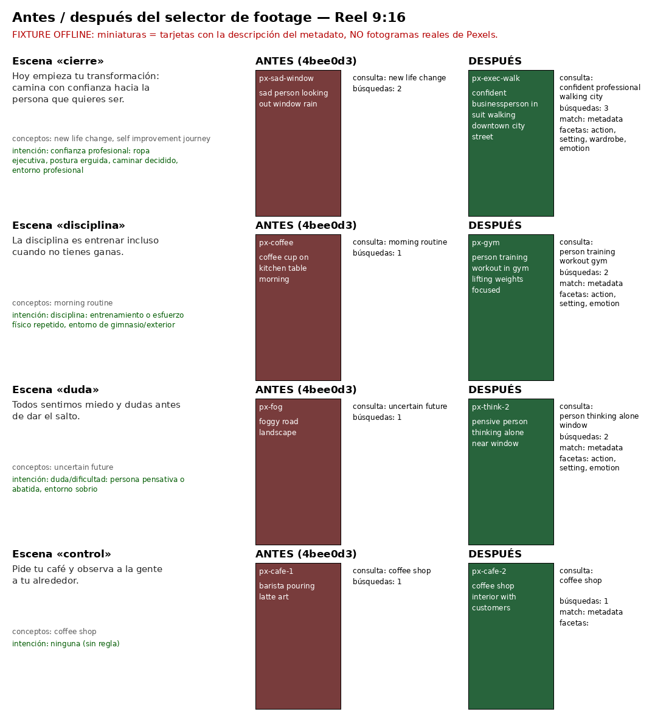

# Reel — narración ↔ footage por criterios observables

Rama de integración `grok/reel-voz-y-footage-20261020`: incluye PR165 (selección de voz, 29506605) sin cambios, más esta mejora.

## Problema
En el Reel real de Hans, la escena final hablaba de transformación personal y de caminar con confianza, y el clip elegido no transmitía eso. Causa en el código (base 4bee0d3):
- Fuera de la apertura, `footage-score.ts` sólo puntuaba lo técnico: concepto principal o alternativo, video o imagen, resolución, duración y repetición de autor. **No miraba la descripción del clip.** En la práctica ganaba el primer resultado de la primera consulta.
- La consulta salía de 2–4 palabras genéricas del guion («new life change»), no del sentido de la narración.
- La reformulación se quedaba con «las 2 primeras palabras» («new life») y perdía los calificadores.

## Qué cambia
1. `scene-visual-intent.ts` convierte la narración de cada escena (es/en) en criterios observables: **acción, entorno, postura, vestuario y emoción**. El léxico es determinista y no usa LLM. Intenciones: confianza profesional, transformación personal, disciplina, concentración, duda, logro, calma. Ejemplo: confianza profesional = ropa ejecutiva (suit/business/blazer), postura erguida, caminar decidido, entorno ciudad/oficina, emoción confident/determined. Cada intención tiene además señales que la contradicen (sad, tired, party…).
2. **Consultas**: con intención, y fuera de la apertura, la consulta enriquecida va primero («confident professional walking city») seguida de los conceptos del guion. Total ≤ 3.
3. **Reformulación**: conserva acción + entorno («business walking»), no las dos primeras palabras.
4. **Puntuación**: +2 por faceta presente en los metadatos (máx. +10) y −4 por señal contradictoria. Sin intención: +1 por palabra del concepto presente en los metadatos (máx. +3). Con intención se requieren dos facetas y ninguna contradicción antes de aceptar video o imagen. Sin coincidencia suficiente se agotan las búsquedas acotadas antes del respaldo técnico. La apertura conserva íntegros su ranking y su puerta anteriores.
5. Se registra por plano `intentId`, `metadataFacets` y `metadataMatch` (`metadata` | `none` | `unchecked`) en `[atomivid:footage]`.

## Qué verifica DE VERDAD (y qué no)
- Verifica: **coincidencia de texto** entre los criterios y los metadatos públicos del proveedor. En Pexels, para video, eso es el slug de la URL de la página («confident-businessperson-walking-…»); para foto, el `alt`. También verifica, como antes, el tipo de medio, la duración mínima, la orientación vertical o la resolución útil 9:16, la no repetición de clip y la diversidad de autor.
- **No** verifica el contenido visual: no se analizan fotogramas ni píxeles. Un slug puede ser inexacto, y un buen clip con slug pobre puede perder. Cada razón del log dice «coincidencia textual, no verificación visual».
- Sin descripción del proveedor: `metadataMatch=unchecked` y 0 puntos; no se inventa pertinencia.
- **Nunca** puntúa atractivo físico ni identidad de género. Esos términos están prohibidos en el léxico y se ignoran al comparar: «man», «woman», «person» y «beautiful» suman igual (test). En vestuario, «businessman», «businesswoman» y «businessperson» valen lo mismo.

## Cuando no hay material adecuado
Orden: video con criterios → reformulación con criterios → imagen con criterios. Después se prioriza un respaldo sin contradicciones explícitas sobre uno contradictorio, aunque tenga menor puntuación. Si sólo queda material contradictorio, se conserva la salida técnica por compatibilidad, con `metadataMatch=none`; esto NO garantiza calidad editorial. Sin descripción se marca `unchecked`. Si no hay nada, aparece el mismo error de antes (`FootageSelectionError`; en la apertura, `OpeningFootageUnavailableError`). **No hay revisión manual obligatoria para el cliente.**

## Límites de búsqueda (acotados, USD 0)
Con los hasta tres conceptos del guion: ≤ 3 consultas de video + 1 reformulación + ≤ 3 de imagen por plano. Sin proveedores nuevos ni llamadas pagadas. La apertura conserva consulta, ranking y regla de pertinencia (`opening-relevance.ts`); no recibe las nuevas heurísticas de narración ni su puntuación.

## Revisión independiente y corrección de integración

Revisión de ChatGPT sobre `5a302da2dab642db1785fa9decebf8eb1a691110`: cinco pruebas de regresión fallaron antes de corregir el selector. Casos: apertura válida vetada por emoción de la narración; evolución natural/hábitos animales/«window» confundidos con motivación; video sin relación que detenía la búsqueda antes de una alternativa pertinente; imagen contradictoria rotulada como coincidente; imagen contradictoria preferida sobre otra coherente.

La corrección preserva el recorrido de apertura, exige evidencia textual suficiente antes de dejar de buscar y aplica las contradicciones también a imágenes. Los disparadores ambiguos de transformación/hábitos/victoria se acotan; cuando hay narración, los conceptos alternativos no pueden introducir otra intención. Sigue siendo un léxico limitado, no un modelo que comprende cualquier tema ni una inspección de fotogramas.

Verificación local de la corrección: 46 pruebas focalizadas y 2020 unitarias aprobadas; TypeScript aprobado. No hay cambios en voz, ledger, migración o gasto de proveedores. Los ejemplos anteriores son fixtures sintéticos de Grok, no observaciones de videos reales.

## Antes / después (FIXTURE OFFLINE)
No se hicieron búsquedas reales de Pexels: la clave sólo existe como secreto de GitHub y no se expuso. «Antes» = el selector de 4bee0d3; «después» = este código. Catálogo sintético en `src/lib/video/footage-intent.fixture.ts`; script `scripts/qa/footage-intent-before-after.ts`.

Tabla: `docs/qa/footage-intent/tabla.md`.

## Orden de despliegue (incluye PR165)
1. Aplicar `supabase/migrations/20261020200444_reel_voice_selection.sql` **antes** de desplegar el nuevo worker. Su SELECT necesita `reel_voice_id` aunque el selector esté apagado.
2. Desplegar web y worker de este SHA con `REEL_VOICE_SELECTION_ENABLED` apagado y comprobar un Reel con la voz por defecto. La mejora de footage no tiene flag ni migración: entra con el worker.
3. Activar el selector de voz en el piloto (ver docs/REEL_VOICE_SELECTION.md).
Rollback de footage: revertir el commit de esta mejora. No toca datos, ledger ni límites de gasto.
